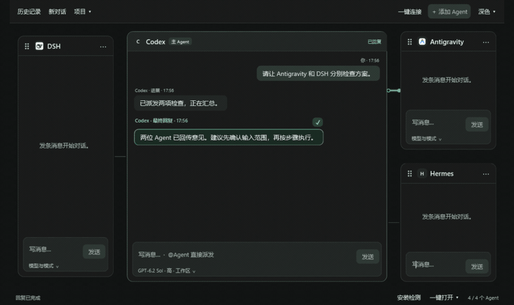

# RelayPane

[简体中文](README.md) · **English**

RelayPane is a Windows desktop app for coordinating multiple AI agents in one workspace. Choose a lead agent to assign work and summarize results. You can also ask a supporting agent to take over directly.



> The demo uses sample conversations. [Dark workspace](docs/media/workspace-dark.png) · [Installation check](docs/media/install-check.png)

## What it does

- **Work together in one window.** Show up to four chat panes and follow assignments, replies, and progress across agents.
- **Share a project folder.** The lead and supporting agents use the same working directory. Hermes uses the corresponding mount path in WSL.
- **Keep native sessions.** Stop the current turn and resume in the same session. Available models, reasoning effort, and modes depend on what each native interface supports.
- **Check agent installations.** Check the local entry points for eight agents and open their official setup guides.

## Quick start

1. Install .NET Framework 4.8 and Node.js 20 or newer on Windows.
2. Download the Windows ZIP from [Releases](https://github.com/MillerKing0702/RelayPane/releases). Unzip it, open the `RelayPane-1.0` folder, and run `RelayPane.exe`. You can also build from source using the instructions below.
3. Open the installation check to find the agents you need, then install and sign in to them. The one-click check looks for local entry points. The connection check in the chat view connects to the selected agent.
4. Start a new conversation, choose a lead agent and any supporting agents, and select a working directory under the project menu. Chat as usual or type `@AgentName` to assign work directly.

## Agent integrations

| Agent | Native entry point |
| --- | --- |
| [OpenAI Codex](https://developers.openai.com/codex/quickstart/) | Codex App Server |
| [DeepSeek Harness](https://github.com/deepseek-ai/deepseek-harness) | DSH ACP profile |
| [Google Antigravity](https://antigravity.google/docs/ide/extensions/acp/) | `agy acp` in the Antigravity CLI |
| [Hermes Agent](https://hermes-agent.nousresearch.com/docs/getting-started/installation) | `hermes acp` in WSL2 |
| [Claude Code](https://github.com/agentclientprotocol/claude-agent-acp) | Claude Agent ACP adapter |
| [Google Gemini CLI](https://github.com/google-gemini/gemini-cli) | `--acp` in the Gemini CLI |
| [OpenCode](https://opencode.ai/docs/cli/acp/) | OpenCode CLI with ACP support |
| [Qwen Code](https://github.com/QwenLM/qwen-code) | `--acp` in Qwen Code |

RelayPane 1.0 has been tested on Windows with native connections to Codex, DeepSeek Harness, Antigravity, and Hermes. The other four integrations passed local protocol tests. Live message exchange still needs to be verified after installation and sign-in. Claude Code also requires its ACP adapter.

## Build from source

Run these commands from the source directory in Windows PowerShell.

```powershell
node --test tests/AgentBridge.test.cjs
.\Build.ps1
```

The build produces `bin/RelayPane.exe`. The build script downloads pinned NuGet dependency versions and verifies their SHA-256 hashes.

## Repository layout

| Directory | Contents |
| --- | --- |
| `src` | Window, session, and agent connection code |
| `tests` | Automated tests for connections, settings, and collaboration |
| `assets` | App icon |
| `docs` | Interface demos and third-party notices |
| `scripts` | Dependency download and Windows packaging scripts |

`Build.ps1` and `Export-Source.ps1` are in the repository root. After building, run `scripts/Package-Windows.ps1` to create the Windows ZIP. The ZIP extracts into a single top-level folder named `RelayPane-1.0`.

## Local data and permissions

RelayPane stores history and settings in the current user's local application data directory. Model requests go through each agent's native connection and are subject to that agent's terms and data policies. Agents coordinate over a local loopback connection secured with a randomly generated token. When you assign work to an agent, that agent receives the task content.

RelayPane handles ACP tool confirmations automatically. In Codex, you can choose to require approval on request. File access and command permissions depend on the agent's runtime and the selected permission settings. When reporting an issue, include the version and steps to reproduce it, and remove secrets, personal paths, and private conversations from your examples.

`Export-Source.ps1` uses `ReleaseFiles.txt` to select files for the source distribution. The export includes source code, documentation, and demo images. See [MarkdownNotices.txt](docs/MarkdownNotices.txt) for dependency licenses.

## Why I built RelayPane

I'm an undergraduate, and I built RelayPane together with Codex. While using the ChatGPT 6 series for recent tasks, I found that clarifying requests back and forth often took more effort than I expected. I wanted a single window where agents suited to planning, execution, and review could work together like a small development team. I also wanted more options for which tools to use. RelayPane depends on agents continuing to provide native interfaces, so compatibility can change as those interfaces evolve.

Coursework takes up a lot of my time, so there may be rough edges. If something goes wrong, please open an issue with steps to reproduce it. If you'd like to help improve RelayPane, you're welcome to start a discussion in an issue or submit a pull request.

## License

[MIT](LICENSE)
