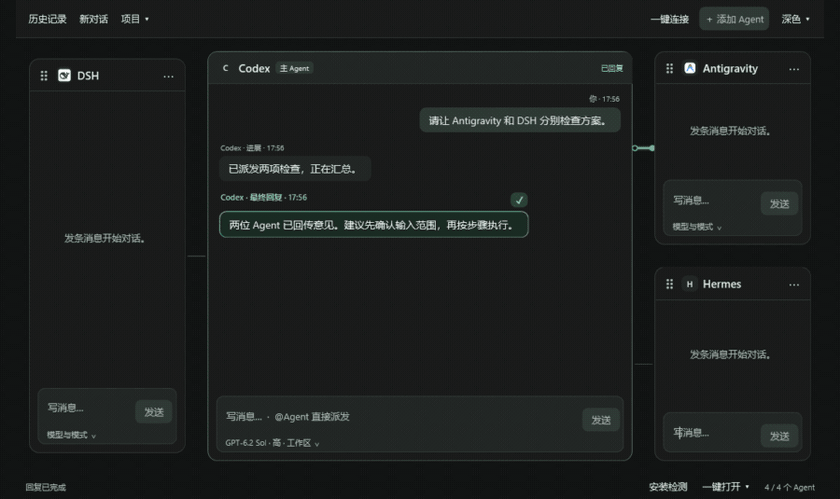

# RelayPane

**简体中文** · [English](README.en.md)

一个 Windows 桌面应用，让多个 AI Agent 在同一个工作区里分工。你选一个主 Agent，由它分派工作和汇总结果，也可以随时点名让某个辅助 Agent 接手。



> 动图展示的是用示例对话生成的界面预览。[深色工作区](docs/media/workspace-dark.png) · [安装检测](docs/media/install-check.png)

## 能做什么

- **同屏协作。** 一个工作区最多显示四个聊天框，可查看 Agent 间的派发、回信和进度。
- **共用项目目录。** 主辅 Agent 使用同一个工作目录。Hermes 在 WSL 中使用对应的挂载路径。
- **保留原生会话。** 停止当前轮后可以在原会话继续。模型、思考强度和模式按原生接口支持情况显示。
- **检测安装。** 一次检查八种 Agent 的本机入口，并打开各自的官方教程。

## 快速上手

1. 在 Windows 上准备 .NET Framework 4.8 和 Node.js 20 或更新版本。
2. 从 [Releases](https://github.com/MillerKing0702/RelayPane/releases) 下载 Windows ZIP，解压后打开 `RelayPane-1.0` 文件夹，运行 `RelayPane.exe`。也可以按下文从源码构建。
3. 打开「安装检测」，安装并登录你需要的 Agent。「一键检测」检查本机入口，聊天页的连接检测会与所选 Agent 握手。
4. 新建对话，选主 Agent 和辅助 Agent，在「项目」选择工作目录。可以直接聊天，也可以用 `@Agent名称` 点名派发。

## Agent 接入

| Agent | 原生入口 |
| --- | --- |
| [OpenAI Codex](https://developers.openai.com/codex/quickstart/) | Codex App Server |
| [DeepSeek Harness](https://github.com/deepseek-ai/deepseek-harness) | DSH ACP profile |
| [Google Antigravity](https://antigravity.google/docs/ide/extensions/acp/) | Antigravity CLI 的 `agy acp` |
| [Hermes Agent](https://hermes-agent.nousresearch.com/docs/getting-started/installation) | WSL2 中的 `hermes acp` |
| [Claude Code](https://github.com/agentclientprotocol/claude-agent-acp) | Claude Agent ACP 适配器 |
| [Google Gemini CLI](https://github.com/google-gemini/gemini-cli) | Gemini CLI 的 `--acp` |
| [OpenCode](https://opencode.ai/docs/cli/acp/) | 支持 ACP 的 OpenCode CLI |
| [Qwen Code](https://github.com/QwenLM/qwen-code) | Qwen Code 的 `--acp` |

1.0 已在 Windows 对 Codex、DSH、Antigravity 和 Hermes 做过原生连接验证。其余四项完成了本地协议测试，仍需在安装并登录后验证实际收发。Claude Code 还需要对应的 ACP 适配器。

## 从源码构建

在 Windows PowerShell 里进入源码目录，运行：

```powershell
node --test tests/AgentBridge.test.cjs
.\Build.ps1
```

产物为 `bin/RelayPane.exe`。构建脚本获取固定版本的 NuGet 依赖，并校验 SHA-256。

## 仓库结构

| 目录 | 用途 |
| --- | --- |
| src | 窗口、会话和 Agent 连接代码 |
| tests | 连接、设置和协作的自动化测试 |
| assets | 应用图标 |
| docs | 界面演示和第三方许可 |
| scripts | 依赖下载与 Windows 打包脚本 |

Build.ps1 和 Export-Source.ps1 保留在根目录。构建完成后，运行 scripts/Package-Windows.ps1 可以生成 Windows ZIP。解压时只会创建一个 RelayPane-1.0 顶层文件夹。

## 本机数据与权限

RelayPane 在当前用户的本机应用数据目录保存历史和设置。模型请求通过各 Agent 的原生连接发送，请按各自的服务条款和数据政策使用。Agent 之间通过带随机令牌的本机回环连接协作；交给另一个 Agent 的任务内容会由该 Agent 处理。

客户端会自动处理 ACP 工具确认，Codex 可选择按需确认。实际文件和命令权限取决于原生 Agent 的运行环境及所选权限。反馈问题时，可以提供版本和复现步骤，并把密钥、个人路径与私人对话从示例里删掉。

`Export-Source.ps1` 按 `ReleaseFiles.txt` 导出发布源码。发布目录包含源码、文档和演示图，依赖许可见 [MarkdownNotices.txt](docs/MarkdownNotices.txt)。

## 为什么做这个项目

我是本科生，RelayPane 由我与 Codex 共同完成。最近用 ChatGPT 6 系列处理一些任务时，我发现来回澄清经常比预想中更费力。我想把擅长规划、执行和复核的 Agent 放到一个窗口里，像小型研发团队一样分工，也给自己多留一些工具选择。这个想法依赖各 Agent 继续提供原生接口，今后的兼容性也会随上游变化。

平时课业占用不少时间，项目难免有疏漏。遇到问题，欢迎在仓库的 **Issues** 说明复现过程；想一起改进，也欢迎先开 Issue 讨论，或提交 **Pull Request**。

## 许可证

[MIT](LICENSE)
